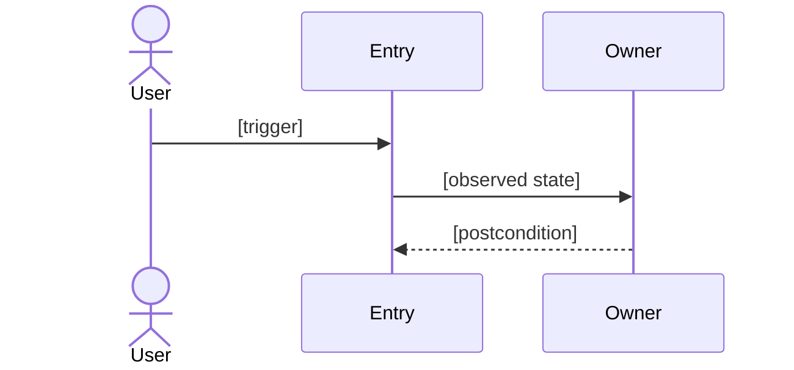

<!-- plan-mode: full -->
<!-- plan-schema: causal-v1 -->
# 実装計画書: [topic]

- 作成日時: [YYYY-MM-DD HH:MM]（base: [branch]@[short-sha]）
- 入力タイプ: [corrective-single / corrective-bundle(N>=2) / feature-gap]
- 診断・モデル正本: `[この plan.md 自身のリポジトリ相対パス]`
- 進捗台帳: `[docs/.../<prefix>-<topic>-todo.md]`（正本。進捗はここだけを更新する）
- goal prompt: `[docs/.../<prefix>-<topic>-goal-prompt.md]`
- HTML ビュー: `[docs/.../<prefix>-<topic>-plan.html]`（閲覧用。正本はこの MD）
- 改訂履歴: [YYYY-MM-DD HH:MM 初版]

## 1. 目的

[この変更で達成することを1〜3文で書く]

- In scope: [対象]
- Out of scope: [対象外。§10 の「やらないこと」に転記する]

## 2. 事前調査結果

| 調査 | コマンド / 対象 | 結果（実測） |
| --- | --- | --- |
| ベースライン | `[go test ./... など]` | [exit 0 / 失敗内容] |
| 外部依存の実測 | `[curl など]` | [ステータス・レスポンス形] |

- 未実施調査と理由: [項目 / 理由。無ければ「なし」]

## 3. 既存実装の理解

- 現状フロー: [入口] → [主要処理] → [保存・出力]
- 既存制約: [タイムアウト、上限、保存形式、依存ライブラリ]
- 既存テストと欠け: [あるもの / 無いもの]
- 読了ファイル一覧: 付録Aに記載

## 4. 因果分析

Finding は、独立して再現または確認できる failure か未充足要求である。外部の報告件数をそのまま数えず、同じ観測事象は1行に正規化する。variant 探索で兄弟事象を発見したら台帳へ追加する。

- 初期入力の単位は独立して検証できる主張とし、一つの報告に複数の failure があれば先に分割する。
- `corrective-bundle(N)` の N は2以上とし、I-01..I-N を重複なく全件割り当てる。
- 複数入力を一つの Finding に正規化する場合は `I-01, I-02` のように同じ Input Ref セルへ書く。
- variant 探索で追加した Finding は `variant: V-01` と書き、該当 Variant の扱いでも同じ Finding を include する。
- 一つの Input Ref を複数 Finding へ重複させない。

### 4.1 Finding 台帳

| Finding | Input Ref | 観測された failure / 未充足要求 | 期待動作 | 出典・再現証拠 |
| --- | --- | --- | --- | --- |
| F-01 | I-01 | [観測可能な事象] | [期待する状態] | `[issue、テスト、ログ、path:line]` |

### 4.2 Cause 仮説と判定

因果関係は多対多でよい。`because` の収束は仮説生成にだけ使い、同じ傘語へ寄せただけでは Cause を併合しない。各 Finding は少なくとも1つの採用 Cause に関連付ける。

#### Cause C-01: [原因の名前]

- 関連 Finding: F-01
- error state / 発生機構: [failure の直前に内部で何が誤った状態になるか]
- 近接原因: [直接の発火条件]
- 違反した不変条件: [常に成立すべきだった条件]
- 設計原因・寄与条件: [データ所有、境界、状態表現、書き込み経路などの設計上の原因]
- 証拠: `[path:line、検索コマンド、テスト、ログ]`
- falsifier: [この Cause 仮説が誤りだと判定できる観測]
- 判定: [採用 / 棄却 / 未確定。未確定は Unclear Points に同じ Cause ID を記載]

## 5. 解決の概念モデル

原因をコードパターンへ即変換せず、まず「何が正で、何が派生で、誰が更新し、どの境界で整合させるか」を固定する。

#### Model M-01: [一文で説明できるモデル名]

- 対象 Cause: C-01
- authoritative source: [正となる事実と保存場所]
- derived projection: [正から導出・同期される状態。非該当なら `対象外: 理由`]
- 責務の owner: [更新責務を持つモジュール / actor]
- identity / boundary: [同一性、集約、tenant、transaction の境界]
- state / time semantics: [current、履歴、削除、競合時の意味]
- 成立させる不変条件: [このモデルの下で常に成立する条件]

## 6. 修復モデル

reconcile、状態機械、台帳と投影、単一 writer などの実装パターンは、概念モデルを実現する手段として選ぶ。パターン名から設計を逆算しない。

#### Repair R-01: [修復または実現メカニズム]

- 対象 Model: M-01
- authoritative / observed state: [比較・入力する desired / actual state]
- mechanism: [何を計算し、何を書き換えるか]
- trigger: [いつ起動するか]
- enforcement point: [不変条件を一か所で強制する境界]
- transaction boundary: [原子性の境界。非該当なら `対象外: 理由`]
- postcondition: [完了後に機械検証できる状態]
- idempotency: [再実行時の意味。非該当なら `対象外: 理由`]
- concurrency control: [競合時の制御。非該当なら `対象外: 理由`]
- cleanup / migration: [既存データの修復。非該当なら `対象外: 理由`]
- retired paths: [削除または無効化する旧 writer / predicate。非該当なら `対象外: 理由`]

## 7. 論理的変更単位

LCU はファイルや報告単位ではなく、同じ不変条件、Target Model、Repair postcondition で閉じ、一つの変更単位として検証できる範囲である。M=N は正常であり、無理に束ねない。

### 7.1 LCU マップ

| LCU | Primary Finding | Cause | Target Model | Repair | 併合・分離の根拠 | 実装先 |
| --- | --- | --- | --- | --- | --- | --- |
| LCU-01 | F-01 | C-01 | M-01 | R-01 | 単独: [1 Finding だけの理由。複数 Finding を束ねるなら `併合:`、分けるなら `分離:`] | Step 1 |

Primary Finding の所属だけを排他的にする。Cause、Model、Repair は複数 LCU から参照してよい。
一つの LCU を複数 Step で実装する場合、実装先を `Step 1, Step 2` のように列挙する。

### 7.2 同型探索（variant analysis）

既知 Finding だけを直さず、同じ predicate、writer、状態遷移、判断の複製、別入口、旧修復経路をコードベース全体から探す。

#### Variant V-01: [探索対象]

- Seed: [F-01 / C-01 / R-01 のどこから探索を広げたか]
- 探索軸: [predicate / writer / state transition / duplicate decision / entrypoint / bypass]
- Query / scope: `[rg -n '...' path など実行した検索]`
- 結果・証拠: [件数と対象。0件でも明記]
- 扱い: [include: F-01 — 同じ postcondition で閉じるため / exclude: 別の authoritative source を持つため]
- LCU: LCU-01

## 8. 解決アプローチ比較（必要な場合のみ）

現実的な案が2つ以上残る判断だけ比較する。グローバルな「メンタルモデル候補」を作る必要はない。比較しない場合は表を削除し、次の1行だけ残す。

比較不要: [要求、既存契約、可逆性などから方式が一つに定まる具体的理由]

比較する場合は上の `比較不要` 行を削除し、判断または LCU ごとに次の表を置く。複数表を置いてよい。

- 比較対象: [LCU-01 / 判断名]

| 軸 | 案1: [名前] | 案2: [名前] |
| --- | --- | --- |
| 要求・不変条件・安全性を満たすか | PASS [根拠] | PASS [根拠] |
| [差が出る軸1] | [◎○△× + 根拠] | [◎○△× + 根拠] |
| [差が出る軸2] | [◎○△× + 根拠] | [◎○△× + 根拠] |
| 歪み | [無理が出る部分] | [無理が出る部分] |
| この案が勝つ現在条件 | [In scope 内の条件] | [In scope 内の条件] |
| 判定 | 採用 | 不採用 |

## 9. 設計判断

比較を捏造しない。代替案が現実に残る判断は §8 で比較し、ここには結論と根拠を記録する。

| 判断 | 採用 | 根拠 | LCU |
| --- | --- | --- | --- |
| [API / データモデル / エラー挙動] | [決定] | [不変条件・証拠・比較結果との接続] | LCU-01 |

設計セルフチェック:

- [ ] authoritative source と writer が一意に説明できる
- [ ] Repair の postcondition が Finding の期待動作を覆う
- [ ] 同じ設計判断を複数モジュールへ漏らしていない
- [ ] 頼まれていない抽象・設定を入れていない
- [ ] 残るエラーだけを処理対象にしている

## 10. 不変条件・逸脱禁止

- 触らないパス: [`path/**`]
- 変えない挙動・UI: [既存契約]
- やらないこと: [Out of scope の転記]
- 隣接コードのついで改善をしない。発見事項は報告に残す
- 許可パスリスト: [`internal/foo/**`, `src/pages/Bar/**` — `git diff --name-only` が外へ出たら停止。計画成果物と開始前から dirty だったファイルは除外]

## 11. Hard Gate

- 着手前 Gate（Definition of Ready）:
  1. [着手前に確定すべき事項]
- Step 完了 Gate 一覧（詳細は §13）:

| Step | Command | Expect |
| --- | --- | --- |
| 1 | `[command]` | [exit 0 / 0件など] |

- Gate 不通過時: 次 Step に進まず、todo.md を `[!]` に更新する。

## 12. 変更対象ファイル

| パス | 新規/更新 | 目的 | 対応 Step |
| --- | --- | --- | --- |
| `[path]` | 更新 | [目的] | 1 |

## 13. 実装ステップ

### Step 1: [名前]

- Primary LCU: LCU-01
- Shared LCU: [LCU-02, LCU-03 — 共有基盤を先に作るため。共有しない場合はこの行を削除]
- 変更ファイル: `[path]`
- 実装内容:
  1. [作業]
- 完了条件 (DoD): `[command]` が [機械判定可能な値]
- 実行コマンド: `[command]`
- 失敗時の切り分け: [任意]
- Hard Gate:
  - Command: `[command]`
  - Expect: [exit 0 / 0件など]

## 14. テスト計画

- 自動テスト: `[command]`
- 手動テスト: [ケース]
- 実環境動作確認（最低1つ）: `[migration、実URL、実データ確認コマンド]`

## 15. リスクと対策

| リスク | 対策 | 対応する Step / Todo |
| --- | --- | --- |
| [リスク] | [対策] | [Step 1 / todo #3] |

## 16. Unclear Points

`Unclear Points: None（実装外として除外した論点: なし）`

不明点がある場合は None 行を削除し、Point / Why / Impact / Need / Fallback / 推奨で列挙する。未確定 Cause は Cause ID を含める。

## 17. Resolved Points

| # | 論点 | 決定 | 根拠 | 反映先 |
| --- | --- | --- | --- | --- |
| 1 | [論点] | [決定] | [発言・証拠] | [セクション] |

## 18. TodoList

正本は todo.md。同じ Primary LCU を転記する。

- [ ] Step 1 (LCU-01): `[path]` [やること]（Gate: `[command]`）
- [ ] テスト: `[command]`
- [ ] ドキュメント反映: `[path]`

## 19. 図

Mermaid ソースは本文にインラインで置く。Repair の trigger、enforcement point、postcondition を図へ反映する。

図を省略する場合: `図の省略理由: [理由]`

## 20. Definition of Done

1. todo.md の全行が `[x]` または `[-]`
2. cancelled でない全 Step の Hard Gate が PASS
3. `[実環境動作確認コマンド]` が成功
4. 完了報告に「計画書からの逸脱」があり、新規 variant、LCU 境界変更、postcondition 変更の有無を記載

## 付録A. 読了ファイル一覧

読了ファイル [N] 件

1. `[path]` - [役割]

